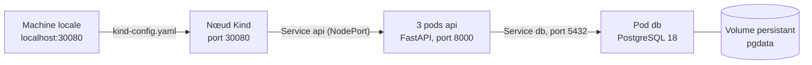
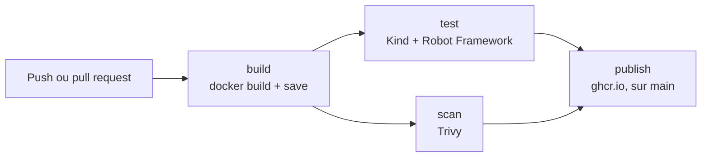

# Projet_Devops

[](https://github.com/GSafaSU/Projet_Devops/actions/workflows/ci.yml)

Une API de gestion de tâches (FastAPI + PostgreSQL), conteneurisée avec Docker, déployée sur Kubernetes et livrée par une chaîne CI/CD qui la teste et l'analyse avant chaque publication.

> **Contexte.** Projet d'initiation DevOps. L'application est fournie : mon travail porte sur tout ce qui l'entoure, de la conteneurisation à la livraison.

## Points clés

- **Docker** : image basée sur `python:3.12-slim`, exécutée par un utilisateur non root, avec des couches ordonnées pour profiter du cache.
- **Kubernetes** : cluster local Kind de 3 nœuds ; 3 réplicas de l'API derrière un Service ; PostgreSQL avec stockage persistant ; mot de passe dans un Secret ; sondes liveness et readiness ; mises à jour progressives et retour arrière.
- **CI/CD** : avec GitHub Actions, l'image est construite une seule fois, testée dans un cluster Kind jetable, analysée par Trivy, puis publiée sur GitHub Container Registry.
- **Tests d'acceptation** : Robot Framework, lancés à l'identique en local et en CI.
- **Branche protégée** : toute modification passe par une pull request, qui ne se fusionne que si la CI est verte.

## Architecture



Le fichier `kind-config.yaml` relie le port 30080 de la machine à celui d'un nœud. Le Service `api`, de type NodePort, confie chaque requête à l'un des trois pods prêts. L'API joint la base par le Service `db`, et les données vivent dans un volume persistant, hors du pod.

## Pipeline CI/CD



| Job | Rôle |
| --- | --- |
| `build` | Construit l'image et l'exporte en archive, transmise aux autres jobs comme artefact. |
| `test` | Crée un cluster Kind avec `kind-config.yaml`, y charge l'image, la déploie avec les manifestes de `k8s/`, puis lance les tests Robot Framework. Le rapport est conservé 7 jours. |
| `scan` | Analyse l'image avec Trivy, épinglé par digest. Une faille HIGH ou CRITICAL qui a un correctif fait échouer le job. |
| `publish` | Sur `main` uniquement, si `test` et `scan` sont verts : pousse l'image testée sur `ghcr.io/gsafasu/projet_devops`, avec les 7 premiers caractères du commit pour tag. |

Un ruleset protège `main` : aucun push direct, et une pull request ne se fusionne que si `build`, `test` et `scan` sont verts.

## Lancer le projet en local

Prérequis : Docker, [Kind](https://kind.sigs.k8s.io/) et [kubectl](https://kubernetes.io/docs/tasks/tools/). Le Deployment de l'API utilise l'image publiée par la CI : rien à construire.

```bash
# Le mot de passe de la base, dans un fichier .env jamais versionné
echo "DB_PASSWORD=$(openssl rand -hex 16)" > .env

# Le cluster et le Secret
kind create cluster --name tp-devops --config kind-config.yaml
kubectl create secret generic db-secret --from-env-file=.env

# L'application
kubectl apply -f k8s/
kubectl rollout status deployment/api
curl http://localhost:30080/tasks
```

L'API répond sur <http://localhost:30080>, et sa documentation interactive sur <http://localhost:30080/docs>. Pour tout supprimer : `kind delete cluster --name tp-devops`.

## Lancer les tests d'acceptation

Avec le cluster démarré, et Python 3.12 ou plus récent :

```bash
python3 -m venv .venv
.venv/bin/pip install -r tests/requirements.txt
.venv/bin/robot --outputdir resultats tests/
```

Résultat attendu : `4 tests, 4 passed, 0 failed`, et un rapport dans `resultats/report.html`. Les tests vérifient que l'API est vivante, qu'elle joint sa base, qu'une tâche créée apparaît dans la liste, et qu'une tâche sans titre est refusée.

## API

| Route | Réponse |
| --- | --- |
| `GET /` | Message d'accueil, version et nom du pod qui a répondu. |
| `GET /health` | `{"status":"ok"}` : le processus est vivant (sonde liveness). |
| `GET /ready` | `{"status":"ready"}` si la base répond, `503` sinon (sonde readiness). |
| `GET /tasks` | La liste des tâches. |
| `POST /tasks` | Crée une tâche à partir de `{"title": "…"}`, et répond `201`. |
| `GET /docs` | Documentation interactive générée par FastAPI. |

## Structure du dépôt

```text
.
├── .github/workflows/ci.yml   # Pipeline CI/CD : build, test, scan, publish
├── app/                       # L'API fournie : main.py, requirements.txt
├── k8s/
│   ├── api.yaml               # Deployment de l'API (3 réplicas) et Service NodePort
│   └── db.yaml                # Volume, Deployment PostgreSQL et Service
├── tests/
│   ├── api.robot              # Tests d'acceptation
│   └── requirements.txt       # Robot Framework et RequestsLibrary, versions figées
├── .dockerignore
├── .env.example               # Modèle du fichier .env
├── Dockerfile
└── kind-config.yaml           # Cluster Kind : 3 nœuds, port 30080 publié sur 127.0.0.1
```

## Parcours

| Étape | Contenu | État |
| --- | --- | --- |
| 1 | Conteneurisation avec Docker | Fait |
| 2 | Application multi-conteneurs avec Docker Compose, remplacé depuis par Kubernetes | Fait |
| 3 | CI/CD avec GitHub Actions et publication sur ghcr.io | Fait |
| 4 | Orchestration avec Kubernetes (Kind) | Fait |
| 5 | Fiabilisation : tests d'acceptation, analyse de sécurité, branche protégée | Fait |
| 6 et suivantes | Observabilité, Terraform et Azure, Ansible, Packer, HTTPS, déploiement continu | À venir |

## Technologies

Python 3.12 · FastAPI · PostgreSQL 18 · Docker · Kubernetes 1.37 (Kind 0.33) · GitHub Actions · Robot Framework 7.5 · Trivy 0.76 · GitHub Container Registry